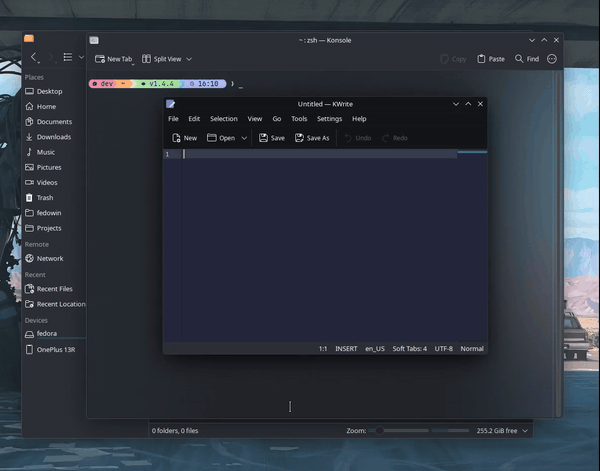

# Klipboard

Klipboard is an independent application based on KDE Klipper from `plasma-workspace`. It runs without `plasmashell` and has no affiliation with KDE or the KDE project.



## Who Klipboard is for

Klipboard may suit you if you:

- Use KDE Plasma 6.8.x.
- Have disabled `plasmashell`.
- Use Quickshell, Waybar, or another desktop panel.
- Want text from clipboard history pasted into the active window on Wayland as soon as you select it, without a separate paste step.

## Install

Download the x86_64 package for your distribution from the [latest release](https://github.com/Vidhan31/klipboard/releases/latest). Release packages install system-wide.

```bash
# Fedora
sudo dnf install ./klipboard-*.rpm

# KDE Neon
sudo apt install ./klipboard_*_amd64.deb

# Arch Linux
sudo pacman -U ./klipboard-*-x86_64.pkg.tar.zst
```

> [!WARNING]
> Run one clipboard manager at a time. Klipboard and managers such as CopyQ both watch the Wayland clipboard and compete to control clipboard selections. Running both can cause missed clipboard updates or paste the wrong item.

> [!WARNING]
> Klipboard supports KDE Plasma 6.8.x. It may not work with earlier Plasma releases.

> [!NOTE]
> The `.deb` package is built on KDE Neon. At the time of writing, other Debian-based distributions do not provide KDE Plasma 6.8. I have not tested the package on Debian or Ubuntu.

> [!WARNING]
> I have tested Klipboard only on Fedora Linux. It should work on other distributions that meet the requirements, but I have not tested them. If it does not work on your distribution, please open an issue.

## Use clipboard history

Press Meta+V to open clipboard history. Select an item to paste it into the active window. Hold Shift while clicking an item or press Shift+Enter to use the terminal paste shortcut. Change global shortcuts in Klipboard's settings.

On Wayland, Klipboard puts the selected item on the clipboard and asks KWin to send paste keys to the active application. Text uses Ctrl+V by default. Shift-click and Shift+Enter use Ctrl+Shift+V. Images always use Ctrl+V.

To start Klipboard when you log in, add it under System Settings > Autostart. If you add it as a command, enter `klipboard`. Klipboard's desktop entry is hidden from application menus, so it may not appear in the application picker.

If you are switching from Klipper, stop it and make sure it does not run while Klipboard is running. To keep using the same shortcut, change the clipboard history shortcut from Klipper to Klipboard in System Settings > Shortcuts.

## Existing Klipper data

Klipboard reuses Klipper's files in place. You do not need to export or import your settings or clipboard history.

- Settings stay in `~/.config/klipperrc`.
- Clipboard history stays in `~/.local/share/klipper/history3.sqlite`. Binary history items stay in `~/.local/share/klipper/data/`.
- Existing global shortcut bindings stay under `[plasmashell]` in `~/.config/kglobalshortcutsrc`. To use the history shortcut with Klipboard, reassign it as described above.

Klipboard reads your existing settings and history from these locations. It does not create a separate history database.

## Requirements

Klipboard requires a KDE Plasma 6.8.x Wayland session. Building it requires:

- A C++23 compiler, CMake 3.16 or newer, Ninja, and Extra CMake Modules (ECM) 6.8 or newer.
- Qt 6.9 or newer with DBus, Qml, Quick, Sql, Widgets, and WaylandClient development components. The test build also needs Qt Test.
- KDE Frameworks 6.8 or newer with Config, CoreAddons, DBusAddons, GlobalAccel, GuiAddons, I18n, IconThemes, KIO, Notifications, Prison, Service, StatusNotifierItem, WidgetsAddons, WindowSystem, and XmlGui.
- Plasma and PlasmaQuick 6.8 or newer, Plasma Wayland Protocols 1.22 or newer, Wayland client development files, libei, and zlib.
- X11 and XCB development files, including the XCB and AUX components, when building with the default `WITH_X11=ON` option. Set `-DWITH_X11=OFF` for a Wayland-only build.

Install the development packages for the dependencies listed above using your distribution's package manager.

## Build and install

Build and install a local copy under `~/.local` to avoid conflicts with the distribution's Plasma files. This differs from the release packages above, which install system-wide under standard system directories:

```bash
cmake -B build -G Ninja \
  -DCMAKE_INSTALL_PREFIX="$HOME/.local" \
  -DBUILD_TESTING=ON
cmake --build build
ctest --test-dir build --output-on-failure -R "klipper-testHistoryCycler|klipper-testHistoryModel|klipper-testUtils"
cmake --install build
```

The installed executable is `~/.local/bin/klipboard`. The `INSTALL_AUTOSTART` CMake option is off by default.

To run the uninstalled build from the project directory:

```bash
QML_IMPORT_PATH="$PWD/build/bin" ./build/bin/klipboard
```

## Credits

Klipboard is based on KDE Klipper, part of `plasma-workspace`. Thanks to the KDE team and all contributors to KDE Plasma and Klipper for their work.
